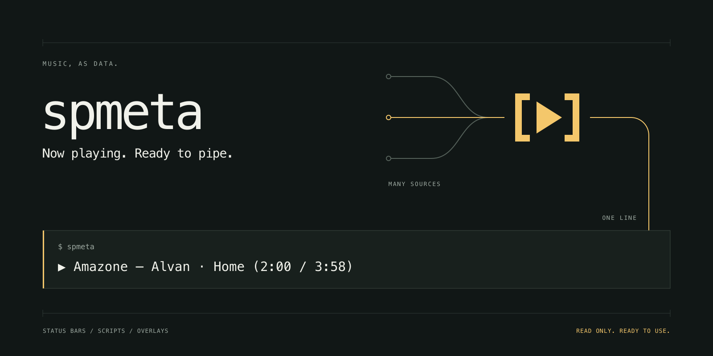

# spmeta



`spmeta` prints the track Spotify is playing right now: one line of text, JSON, your own template, or a Waybar module line. It is built for status bars, scripts, and overlays, and runs on macOS and Linux as a single binary.

```console
$ spmeta
▶ Amazone — Alvan · Home (2:00 / 3:58)
```

`spmeta` is an independent project and is not affiliated with, endorsed by, or sponsored by Spotify. "Spotify" is a trademark of Spotify AB.

Status: early release. `spmeta` reads the Spotify client on this machine, and with a one-time setup it can also read what plays on your other devices ([Web mode](#web-mode)).

## Install

**Homebrew** (macOS and Linux) installs a prebuilt binary from the `bkuberek/tap` tap as a cask:

```bash
brew install --cask bkuberek/tap/spmeta
```

`spmeta` is a command-line binary, so it is published as a cask rather than a formula, because GoReleaser deprecated generating formulae for prebuilt binaries ([deprecations](https://goreleaser.com/deprecations/)). Homebrew on Linux has supported casks that ship Linux binaries since Homebrew 4.5.0 ([release notes](https://brew.sh/2025/04/29/homebrew-4.5.0/)); the `spmeta` cask has Linux builds for amd64 and arm64. Update Homebrew first if the install fails on Linux. The cask removes the macOS quarantine flag from the binary after install, because release binaries are not signed or notarized yet.

**Debian and Ubuntu** (`.deb`) and **Fedora and RHEL** (`.rpm`) packages are attached to each [GitHub Release](https://github.com/bkuberek/spmeta/releases) for amd64 and arm64. Replace `0.1.0` and `amd64` as needed:

```bash
sudo apt install ./spmeta_0.1.0_linux_amd64.deb
sudo dnf install ./spmeta_0.1.0_linux_amd64.rpm
```

**Archives** (`.tar.gz` for macOS and Linux, amd64 and arm64) are on the same page, together with `checksums.txt`. Verify a download before you unpack it:

```bash
grep spmeta_0.1.0_linux_amd64.tar.gz checksums.txt | shasum -a 256 -c
tar -xzf spmeta_0.1.0_linux_amd64.tar.gz spmeta
```

On macOS, a manually downloaded binary is quarantined and the binary is not signed, so macOS refuses to run it. Remove the flag once, before the first run:

```bash
xattr -d com.apple.quarantine ./spmeta
```

Installs through Homebrew and `go install` are not affected.

**Go** builds from source and needs Go 1.26 or newer:

```bash
go install github.com/bkuberek/spmeta/cmd/spmeta@latest
```

Check the result with `spmeta version`.

## Shell completion

The Homebrew cask and the `.deb` and `.rpm` packages install completion for bash, zsh, and fish, and the `spmeta(1)` man page. Bash completion needs the `bash-completion` package. Zsh needs `compinit` in `~/.zshrc`; with Homebrew, also add `$(brew --prefix)/share/zsh/site-functions` to `FPATH` before `compinit`, which the macOS system zsh does not do by default. Release archives contain the same files in `completions/` and `manpages/`.

After `go install`, add the line for your shell to its startup file:

```bash
# ~/.bashrc
eval "$(spmeta completion bash)"

# ~/.zshrc, after compinit
source <(spmeta completion zsh)
```

For fish, save the script where fish loads completions on demand:

```bash
spmeta completion fish > ~/.config/fish/completions/spmeta.fish
```

The scripts complete subcommands, flags, and the values of `--source` and `--format`. See [docs/design/cli.md](docs/design/cli.md#completion) for the details.

## Usage

```bash
spmeta                                       # one line of text
spmeta --format json                         # one JSON object
spmeta --format waybar --watch               # JSON lines for a Waybar module
spmeta --template '{artist} - {title}'       # your own line
spmeta --watch                               # print a line on every change
spmeta doctor                                # check what works, and why not
```

`spmeta` reads the Spotify client running on this machine. It never launches Spotify. With a [Web mode](#web-mode) login it also reads playback on your other devices, such as a phone.

| Flag | Default | Description |
| --- | --- | --- |
| `--format text\|json\|template\|waybar` | `text` | Output format. `--template` alone selects `template` |
| `--template STR` | none | Template using `{field}` placeholders, for example `{state_icon} {artist} - {title}` |
| `--watch` | off | Keep running; print a line only when the track, state, or device changes |
| `--interval SECONDS` | 1 | Poll interval for `--watch`; minimum 0.5; only with `--watch` |
| `--player NAME` | none | Linux: use this MPRIS player (see [Linux](#linux)) |
| `--source auto\|local\|web` | `auto` | Where to read; `web` needs a [login](#web-mode) |
| `--quiet` | off | Print nothing; only set the exit code |
| `--debug` | off | Write diagnostics to stderr; never tokens |
| `--config PATH` | see below | Use this configuration file |

The full flag list, the template fields, and the environment variables are in [docs/design/cli.md](docs/design/cli.md). Defaults can live in `~/.config/spmeta/config.toml` (or `$XDG_CONFIG_HOME/spmeta/config.toml`) and in `SPMETA_*` variables; flags win over both.

## Output formats

**Text** (default) prints one line. A part with no value is left out with its separator.

```text
▶ Amazone — Alvan · Home (2:00 / 3:58)
```

The icon is `▶` playing, `⏸` paused, or `■` stopped.

**JSON** prints one object per line with a stable set of keys, validated by [schema/spmeta.schema.json](schema/spmeta.schema.json). Fields are described in [docs/design/data-model.md](docs/design/data-model.md).

```json
{"schema_version":1,"source":"macos","state":"playing","type":"track","title":"Amazone","artists":["Alvan"],"artist":"Alvan","album":"Home","album_artist":"Alvan","track_number":4,"disc_number":1,"duration_ms":238341,"position_ms":120165,"uri":"spotify:track:4brK3gpPjXArNUlU1hBXTe","url":"https://open.spotify.com/track/4brK3gpPjXArNUlU1hBXTe","artwork_url":"https://i.scdn.co/image/ab67616d0000b273a9ab54d90005cfd439f821e8","isrc":null,"explicit":null,"device":null,"fetched_at":"2026-10-27T17:40:00Z"}
```

**Template** renders one line from `{field}` placeholders. `{{` and `}}` give literal braces, and a missing value renders empty. An unknown field is an error before anything is read.

**Waybar** prints one JSON object per line in the shape of a Waybar custom module with `return-type` set to `json`. `text` is the text-format line, `alt` and `class` are `playing`, `paused`, or `stopped`, `tooltip` lists the title, artists, album, and source, and `percentage` is the progress through the track. `percentage` is left out when the position or duration is unknown.

```json
{"text":"▶ Amazone — Alvan · Home (2:00 / 3:58)","alt":"playing","tooltip":"Amazone\nAlvan\nHome\nSource: macos","class":"playing","percentage":50}
```

Waybar reads `text` and `tooltip` as Pango markup, so `spmeta` escapes `&`, `<`, and `>` in both. Do not set Waybar's `escape` option with this format, or the text is escaped twice. The schema is in [docs/design/cli.md](docs/design/cli.md#waybar).

When nothing is playing, text and template output are empty, JSON prints `null`, Waybar prints `{"text":"","alt":"none","class":"none"}`, and the exit code is 3.

## Exit codes

| Code | Meaning |
| --- | --- |
| 0 | An item is playing, paused, or loaded; output written. Also: watch mode stopped by SIGINT or SIGTERM; successful `auth`, `doctor`, `completion`, `version`, `help` |
| 1 | Unexpected error: unparseable source output, network failure, timeout, Web 5xx after one retry |
| 2 | Usage error |
| 3 | A source is reachable but nothing is loaded, or no Web device is active |
| 4 | No source available: Spotify not running, no MPRIS player, no session bus, not logged in to Web, unsupported platform |
| 5 | Web authentication required: refresh failed, token file unreadable, login aborted or timed out. Run `spmeta auth login` |
| 6 | Permission denied: macOS Automation not granted, or Web 403 (not on the app's allowlist, or the app owner's Premium lapsed) |
| 7 | Rate limited by the Web API and gave up |

Codes 5 and 7, and the Web causes of the others, come from [Web mode](#web-mode).

Every non-zero exit prints `spmeta: <message>` on stderr, sometimes followed by a `hint:` line. `--quiet` suppresses both, except for usage errors.

## Status bars and scripts

These assume `spmeta` is on `PATH`.

**tmux** shows `Artist - Title`, refreshed every 5 seconds, and nothing when idle:

```bash
# ~/.tmux.conf
set -g status-interval 5
set -g status-right '#(spmeta --template "{state_icon} {artist} - {title}" 2>/dev/null)'
```

**Waybar** updates a custom module on each change. The `waybar` format sets the text, tooltip, CSS class, and progress, and an empty text hides the module when nothing plays. Leave Waybar's `escape` option off, because `spmeta` already escapes the markup. The `playing`, `paused`, `stopped`, and `none` classes can be styled in `style.css`.

```json
"custom/spotify": {
  "exec": "spmeta --watch --format waybar",
  "return-type": "json",
  "format": "{}",
  "max-length": 60
}
```

**SketchyBar** polls from a plugin script. The first run needs the macOS permission described [below](#macos): run `spmeta doctor` once from a terminal and allow SketchyBar when macOS asks.

```bash
#!/usr/bin/env bash
# ~/.config/sketchybar/plugins/spotify.sh
label="$(spmeta --template '{artist} – {title}' 2>/dev/null)"
sketchybar --set "$NAME" label="$label" drawing="$([ -n "$label" ] && echo on || echo off)"
```

**Shell scripts** can branch on the exit code:

```bash
if line="$(spmeta --template '{artist} - {title}')"; then
  echo "Now playing: $line"
else
  case $? in
    3) echo "Spotify is idle" ;;
    4) echo "Spotify is not running" ;;
    *) echo "spmeta failed" ;;
  esac
fi
```

Copy-paste configurations for Waybar, SketchyBar, and tmux are in [examples](examples/README.md). More integration examples are in [docs/design/cli.md](docs/design/cli.md#integration-examples).

## macOS

`spmeta` asks Spotify.app for the current track through AppleScript, so macOS requires a one-time Automation permission for the app that runs `spmeta` (Terminal, iTerm, SketchyBar, and so on).

1. Start Spotify.
2. Run `spmeta doctor` in a terminal. macOS shows a prompt; click OK. `doctor` waits up to 120 s for your answer.
3. The `macos` line should read `ok`.

```text
spmeta 0.1.0 (darwin/arm64)
config  ok: /Users/user/.config/spmeta/config.toml not found, using defaults
macos   ok: Spotify is running; Automation permission granted
web     not configured: run 'spmeta auth login' to see playback on other devices (optional)
```

Troubleshooting:

| Symptom | Fix |
| --- | --- |
| Exit 6, "macOS did not allow this app to control Spotify" | Open System Settings > Privacy & Security > Automation, find the app that runs `spmeta`, and turn on Spotify. Then run `spmeta doctor` |
| Exit 1, "Spotify did not respond within 2s" on the first run | macOS is probably waiting for you to answer the prompt. Run `spmeta doctor` |
| Exit 4, "Spotify is not running" | Start Spotify. `spmeta` never launches it |
| Exit 3 with Spotify open | Nothing is loaded yet; press play |
| Works in a terminal, not in a status bar | The status bar app is a different app to macOS. Allow it in the Automation list |

`spmeta doctor` exits 4 and names the failing check when no source works. Add `--debug` to see the cause of each failure.

## Linux

`spmeta` reads Spotify clients that speak MPRIS over the D-Bus session bus. With no `--player`, it tries these in order and uses the first one that is running. If several instances of that player run, the one that is playing wins:

1. `spotify` (the desktop client)
2. `spotifyd`
3. `ncspot`
4. `spotify_player`

Browsers and other MPRIS players are ignored unless you name them. `--player NAME` (or `player` in the config file, or `SPMETA_PLAYER`) selects a player by bus name, such as `spotifyd` or `spotifyd.instance1234`.

`spmeta` needs a session bus: run it inside a desktop session, or start one with `dbus-run-session`. It never autolaunches one. `spmeta doctor` lists the players it finds and marks the one it would read:

```text
spmeta 0.1.0 (linux/amd64)
config  ok: /home/user/.config/spmeta/config.toml not found, using defaults
mpris   ok: reading spotify
        spotify (Playing, selected)
        spotifyd.instance1234 (Paused)
web     not configured: run 'spmeta auth login' to see playback on other devices (optional)
```

The Spotify desktop client often reports its playback position as 0. `spmeta` then leaves `position_ms` null instead of showing a wrong time.

## Web mode

Web mode asks Spotify's servers what plays on your account, so it sees any device: a phone, a speaker, another computer. It needs a one-time setup with your own Spotify app, because Spotify allows only a few users per app. Without a login, `spmeta` never contacts Spotify's servers.

### One-time setup

1. Sign in to the [Spotify Developer Dashboard](https://developer.spotify.com/dashboard) with an account that has **Premium**, and create an app. Tick **Web API** when asked which APIs it uses.
2. Add the redirect URI `http://127.0.0.1:8974/callback`. The dashboard rejects a loopback URI without a port ("This redirect URI is not secure."), so `spmeta` listens on port 8974 by default.
3. Open the app's **User Management** and add the Spotify account you listen with, even if it is the account that owns the app.
4. Copy the app's **Client ID** and log in:

   ```bash
   spmeta auth login --client-id 0123456789abcdef0123456789abcdef
   ```

   Or set `client_id` in `config.toml` (or `SPMETA_CLIENT_ID`) and run `spmeta auth login`. Your browser opens Spotify's consent page; `spmeta` waits up to 180 s for it. `--no-browser` only prints the URL, and `--port` changes the port (register the same one in step 2).

`spmeta auth status` shows the login, `spmeta auth logout` deletes it, and `spmeta doctor` makes one Web request to check that it works. The login is stored in `~/.config/spmeta/token.json` (mode 0600).

### Using it

| Command | What it reads |
| --- | --- |
| `spmeta` (`--source auto`) | This machine first. If nothing plays here, Web is asked next. A playing track wins, local first; otherwise a paused one is shown, local first. Without a login Web is skipped and nothing is requested |
| `spmeta --source web` | Only Web, even while this machine plays. Without a login it exits 4 with "not logged in to the Spotify Web API" |
| `spmeta --source local` | Never Web |

With `--watch`, Web is read at most every `web_interval` seconds (default 3, minimum 1, set in `config.toml`), and only while this machine is not playing. A short rate limit (`Retry-After` of 10 s or less) is waited out in a one-shot read; a longer one exits 7. Watch mode waits and keeps going.

### Limits and upkeep

- **Re-login every 6 months.** Spotify's refresh tokens expire six months after login, and refreshing does not extend that. `spmeta auth status` shows the estimated date and warns 14 days before. When it has passed, `spmeta` exits 5; run `spmeta auth login` again.
- **Development Mode.** A new app is limited to 5 users, each added under User Management. A 403 (exit 6) means your account is not on that list, or the owner's Premium subscription lapsed.
- **Rate limits.** Spotify limits requests per app (exit 7). Keep `web_interval` at its default unless you need less.
- **Revoking access.** Spotify offers no token-revocation endpoint; to revoke access, remove the app at [spotify.com/account/apps](https://www.spotify.com/account/apps/). `spmeta auth logout` only deletes the local token file.

The full flow, the token file, and the error table are in [docs/design/backend-web.md](docs/design/backend-web.md).

## More documentation

Requirements, research, decisions, and the design specs are in [docs/README.md](docs/README.md).

## License

[MIT](LICENSE)
