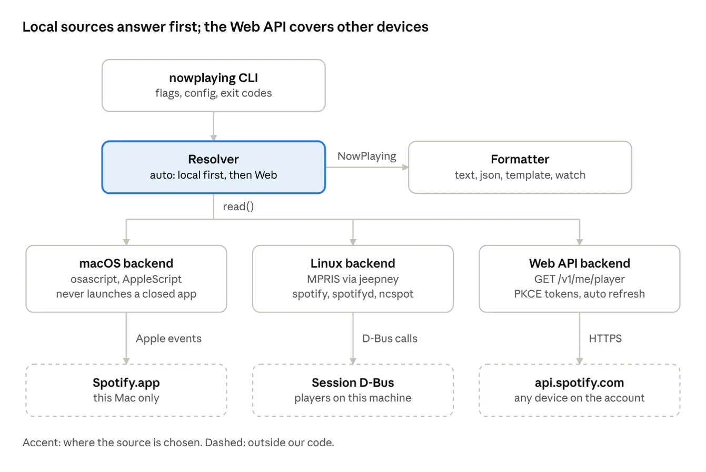

# spmeta — PRD & Spec

Oct 25, 2026 · @Bastian · Revised Oct 27, 2026 after the planning research

Formerly named `nowplaying`; renamed to `spmeta` ([ADR 0003](../decisions/0003-name-spmeta.md)).

## Summary

We will build `spmeta`, a command-line tool for macOS and Linux that prints now-playing metadata for Spotify: the track or episode currently playing. It reads the local Spotify client first (no login needed) and falls back to the Spotify Web API for playback on any device (phone, speaker, web player).

The local-first design is deliberate. Since February 2026, Web API apps in Development Mode need a Premium owner and are capped at 5 users, so the API path must stay optional.

The product is the contract: a versioned JSON schema, documented exit codes, one interface across macOS, Linux, and Web, local-first reads with a Web fallback, and never launching a closed Spotify ([ADR 0001](../decisions/0001-audience-build-vs-wrap.md)). The tool is published for others.

Detailed design lives in [docs/design](../design/); decisions in [docs/decisions](../decisions/README.md); research in [docs/research](../research/). This PRD links to them rather than duplicating them.

### Goals

- One command returns title, artist(s), album, duration, position, play state, artwork URL and Spotify URI.
- Works with zero setup when a Spotify client runs on the same machine.
- Optional Web API mode sees playback on any device on the user's account.
- Scriptable: stable JSON output, a template format, a watch mode and meaningful exit codes.

### Non-goals (v1)

- Playback control (play, pause, skip, volume).
- A GUI, menu-bar app or tray icon.
- Windows support.
- Lyrics, audio features, recommendations or listening history.

## Spotify API landscape (October 2026)

Three sources can tell us what is playing; only the Web API sees other devices, and it carries the most setup friction.

| Source | Sees | Auth | Main constraint |
| --- | --- | --- | --- |
| macOS AppleScript (Spotify.app scripting dictionary) | This Mac's Spotify app | None; macOS asks once for Automation permission | macOS only; app must be running; first call may wait on the consent prompt |
| Linux MPRIS over D-Bus (`org.mpris.MediaPlayer2.spotify` and others) | Any MPRIS player on this machine: Spotify desktop, spotifyd, ncspot, spotify_player | None | Needs a session D-Bus; field quality varies by player |
| Spotify Web API `GET /v1/me/player` | Active playback on any device on the account | OAuth 2.0 Authorization Code + PKCE | Premium owner, own Client ID, 5-user cap in Development Mode, refresh tokens expire after 6 months |

### Web API constraints that shape the design

Details and sources: [research/web-api.md](../research/web-api.md).

- **Development Mode limits.** New apps need a Premium owner, and the app stops working if that subscription lapses (it resumes on resubscription). New apps allow 5 allowlisted users; existing apps keep their prior limits. Client IDs per developer rose to 25 in July 2026. ([migration guide](https://developer.spotify.com/documentation/web-api/tutorials/february-2026-migration-guide), [quota modes](https://developer.spotify.com/documentation/web-api/concepts/quota-modes), [July 2026 changelog](https://developer.spotify.com/documentation/web-api/references/changes/july-2026)) The exact start date (the original draft said February 11, 2026) is not on the fetched pages.
- **Each user brings their own Client ID.** A shared, distributed Client ID would hit the 5-user cap, so the tool asks for the user's own.
- **Removed fields.** Development Mode track objects no longer carry `popularity`, `available_markets` or `linked_from`; albums lost `label`, `popularity`, `album_group`, `available_markets` and `external_ids`. `external_ids` was restored on tracks and albums in March 2026; the changelog does not name ISRC explicitly, so `isrc` may be null. ([February 2026 changelog](https://developer.spotify.com/documentation/web-api/references/changes/february-2026), [March 2026 changelog](https://developer.spotify.com/documentation/web-api/references/changes/march-2026))
- **Player endpoints unchanged.** `GET /me/player` and `GET /me/player/currently-playing` still work. A 204 when nothing is active is widely observed but undocumented. `additional_types` "might be deprecated", so the mapping keys off `item.type`.
- **Scope.** `GET /me/player` needs only `user-read-playback-state`. ([scopes](https://developer.spotify.com/documentation/web-api/concepts/scopes))
- **Refresh tokens.** They expire 6 months after authorization; refreshing does not extend them. Users re-run `spmeta auth login` twice a year. ([refreshing tokens](https://developer.spotify.com/documentation/web-api/tutorials/refreshing-tokens))
- **Redirect URI rules.** HTTPS, or a loopback literal `http://127.0.0.1` / `http://[::1]`; `localhost` is rejected. A loopback URI registered without a port accepts a dynamic port at request time. As of 2026-10-29 the dashboard rejects portless loopback URIs, so spmeta defaults to port 8974. ([redirect URIs](https://developer.spotify.com/documentation/web-api/concepts/redirect_uri))
- **Rate limits.** Quotas are counted per developer account over a rolling 30-second window; exceeding them returns 429 with `Retry-After`, and the body may carry `reason: QUOTA_EXCEEDED`. ([rate limits](https://developer.spotify.com/documentation/web-api/concepts/rate-limits))

## Users and use cases

The primary user is a developer or power user who wants Spotify's current track in their own scripts and status bars.

| Use case | Example | Source it needs |
| --- | --- | --- |
| Status bar widget | tmux, Polybar, Waybar, SketchyBar, xbar show `Artist - Title` | Local, watch mode |
| Shell script / automation | Log tracks, post to a chat status, trigger lights | Local or Web, JSON |
| Streaming overlay | OBS text source updated on track change | Watch mode, template |
| Phone or speaker playback | Music plays from a phone; the laptop shows it | Web API |
| Headless Linux box | Raspberry Pi running spotifyd | Local MPRIS |

## Functional requirements

Priority: P0 ships in v1, P1 ships in v1 if time allows, P2 is later.

| ID | Requirement | Priority |
| --- | --- | --- |
| FR-1 | `spmeta` prints the current track as one line of text and exits. | P0 |
| FR-2 | `--format json` prints one object matching the schema in Output data model. | P0 |
| FR-3 | `--format template --template '{artist} - {title}'` renders any schema field by name. | P0 |
| FR-4 | macOS backend reads Spotify.app via AppleScript without launching the app if closed. | P0 |
| FR-5 | Linux backend reads MPRIS over the session D-Bus, preferring `spotify`, then other Spotify players, using dot-boundary name matching. | P0 |
| FR-6 | `--source auto` (default) resolves local-first and uses Web for active playback elsewhere ([ADR 0005](../decisions/0005-auto-source-resolution.md)); `local` and `web` force one. | P0 |
| FR-7 | `spmeta auth login` runs PKCE in the browser and stores tokens; `logout` and `status` exist. | P0 |
| FR-8 | Web backend reads `GET /v1/me/player?additional_types=episode` and refreshes tokens on 401. | P0 |
| FR-9 | Distinct exit codes for playing, nothing playing, app not running, auth needed and permission denied. | P0 |
| FR-10 | `--watch` emits a new line only when the track or play state changes; JSON mode emits NDJSON. | P1 |
| FR-11 | `spmeta doctor` reports which sources are available and why others are not. | P1 |
| FR-12 | Podcast episodes are reported with `type: episode` and show name in place of album. | P1 |
| FR-13 | `--fields title,artist` trims JSON output to the named fields. | P2 |
| FR-14 | Optional macOS Keychain / Linux Secret Service token storage. | P2 |

## Non-functional requirements

| Area | Requirement |
| --- | --- |
| Latency | Local read returns in under 300 ms; Web read in under 1.5 s on a normal connection. The live probe measured 150–170 ms for a warm macOS Apple event. |
| Polling | Watch mode polls local sources every 1 s and the Web API every 3 s by default; minimum Web interval 1 s. In `auto`, Web is polled only while local is not playing. |
| Rate limits | On 429, sleep for `Retry-After` seconds and back off; never retry in a tight loop. |
| Security | PKCE only, no client secret anywhere. Token file at mode 0600. Tokens and auth codes never logged. |
| Privacy | No telemetry. Only `api.spotify.com` and `accounts.spotify.com` are contacted, and only in Web mode. |
| Platforms | macOS 13+ (Apple silicon and Intel); Linux with a session D-Bus (GNOME, KDE, Sway, Hyprland, headless with `dbus-run-session`); `arm64` and `amd64`. |
| Dependencies | Go; standard library plus `github.com/godbus/dbus/v5` (Linux build only) and `github.com/BurntSushi/toml` ([ADR 0006](../decisions/0006-dependencies.md)). |
| Install | One static binary: Homebrew tap, `.deb` / `.rpm`, GitHub Releases archives, `go install`; one command named `spmeta` ([release.md](../design/release.md)). |
| Versioning | Semantic Versioning; `CHANGELOG.md` generated from Conventional Commits ([ADR 0008](../decisions/0008-versioning-and-release.md)). |
| Robustness | A missing optional field is `null` in JSON, never a crash. Unknown fields from Spotify are ignored. |

## Architecture and tech stack

A thin CLI hands every request to a resolver, which asks the backends in order and passes one normalized `NowPlaying` object to the formatter. Package layout, interfaces and the resolver algorithm: [architecture.md](../design/architecture.md).



Only the Web backend touches the network, and only after `auth login`; the two local backends need no credentials.

| Choice | Decision | Why |
| --- | --- | --- |
| Language | Go (module `github.com/bkuberek/spmeta`, toolchain 1.27, `go 1.26` in `go.mod`) | Single static binary; negligible startup within the 300 ms budget ([ADR 0002](../decisions/0002-language-go.md)) |
| CLI | Standard library `flag` with hand-rolled subcommand dispatch | No dependency for four commands |
| HTTP | `net/http` (client and loopback callback server) | Two endpoints and one callback |
| D-Bus | `github.com/godbus/dbus/v5`, Linux build only | Pure Go, typed, maintained |
| Config | TOML via `github.com/BurntSushi/toml` | Read-only, optional config |
| Packaging | goreleaser (archives, Homebrew tap, nfpm `.deb`/`.rpm`), release-please for versioning and `CHANGELOG.md`, `go install` | One-command install on both OSes ([ADR 0008](../decisions/0008-versioning-and-release.md)) |
| Quality | `go test` (table-driven, golden files), `go vet`, `golangci-lint` | Gates for each milestone |

## Output data model

Every backend maps into one `NowPlaying` object; JSON output is that object, and `schema_version` lets scripts detect changes. Full field rules: [data-model.md](../design/data-model.md); schema: [spmeta.schema.json](../../schema/spmeta.schema.json) (JSON Schema draft 2020-12).

```json
{
  "schema_version": 1,
  "source": "macos",
  "state": "playing",
  "type": "track",
  "title": "Song Title",
  "artists": ["Artist One", "Artist Two"],
  "artist": "Artist One, Artist Two",
  "album": "Album Name",
  "album_artist": "Artist One",
  "track_number": 3,
  "disc_number": 1,
  "duration_ms": 215000,
  "position_ms": 42000,
  "uri": "spotify:track:4uLU6hMCjMI75M1A2tKUQC",
  "url": "https://open.spotify.com/track/4uLU6hMCjMI75M1A2tKUQC",
  "artwork_url": "https://i.scdn.co/image/...",
  "isrc": null,
  "explicit": null,
  "device": null,
  "fetched_at": "2026-10-25T17:40:00Z"
}
```

- `source`: `macos` | `mpris` | `web`.
- `state`: `playing` | `paused` | `stopped`. Nothing playing at all is not an object: it is exit code 3 and empty output (`null` in JSON mode).
- `type`: `track` | `episode` | `ad` | `unknown`. For episodes, `album` holds the show name.
- `artist` is `artists` joined with `", "` for templates.
- `device` (Web only): `{"name": "...", "type": "Smartphone", "volume_percent": 70}`.

### Field availability by source

Corrected with the live probe and research; the authoritative table is in [data-model.md](../design/data-model.md).

| Field | macOS AppleScript | Linux MPRIS | Web API |
| --- | --- | --- | --- |
| title | `name` | `xesam:title` | `item.name` |
| artists | `artist` (one string) | `xesam:artist` (list) | `item.artists[].name`; episodes: `item.show.publisher` |
| album | `album` | `xesam:album` | `item.album.name` / `item.show.name` |
| duration\_ms | `duration` (milliseconds, verified live; the dictionary wrongly says seconds) | `mpris:length` (µs ÷ 1000) | `item.duration_ms` |
| position\_ms | `(player position * 1000) as integer` (seconds × 1000) | `Position` (µs ÷ 1000); null for Spotify desktop when 0 while playing | `progress_ms` |
| state | `player state` | `PlaybackStatus` | `is_playing` |
| uri | `id` (returns `spotify:track:…`) | `mpris:trackid` normalized to `spotify:<type>:<id>`, else from `xesam:url` | `item.uri` |
| url | derived `https://open.spotify.com/{type}/{id}` from the URI (`spotify url` also returns the URI, not a web URL) | `xesam:url` when present, else derived | `item.external_urls.spotify` |
| artwork\_url | `artwork url` | `mpris:artUrl` | largest `item.album.images[]` |
| track / disc number | `track number` / `disc number` | `xesam:trackNumber` / `xesam:discNumber` | `item.track_number` / `item.disc_number` |
| isrc | — | — | `item.external_ids.isrc` (may be absent) |
| explicit | — | — | `item.explicit` |
| device | — | — | `device` |

On macOS, `artists` is a one-item list from the single `artist` string; do not split on commas, since artist names can contain them.

## CLI interface

One binary, a default read command and three subcommands. Complete flag, template, configuration and integration reference: [cli.md](../design/cli.md).

```text
spmeta [--source auto|local|web] [--format text|json|template] [--template STR]
       [--player NAME] [--watch] [--interval SECONDS] [--quiet] [--debug] [--config PATH]
spmeta auth login [--client-id ID] [--port PORT] [--no-browser]
spmeta auth logout
spmeta auth status
spmeta doctor
spmeta version | spmeta --version
```

- Default text output: `▶ Title — Artist · Album (1:23 / 3:35)`; `⏸` when paused.
- `--template` uses a `{field}` mini-syntax with field names from the schema (`{title}`, `{artist}`, `{position}`, `{duration}`), with `position` / `duration` pre-formatted as `m:ss` (`h:mm:ss` from one hour). Missing fields render as empty strings; unknown names are a usage error.
- `--player NAME` picks an MPRIS player on Linux.
- `--quiet` prints nothing and only sets the exit code.
- `--debug` writes backend diagnostics to stderr, never tokens.

### Exit codes

| Code | Meaning |
| --- | --- |
| 0 | A track or episode is playing or paused; output written |
| 1 | Unexpected error |
| 2 | Bad arguments |
| 3 | Spotify is running but nothing is loaded / no active device |
| 4 | No source available (app not running, no MPRIS player, not logged in) |
| 5 | Web auth required or refresh failed; run `spmeta auth login` |
| 6 | Permission denied (macOS Automation not granted; Web 403) |
| 7 | Rate limited and gave up |

### Configuration

- Config: `$XDG_CONFIG_HOME/spmeta/config.toml` (default `~/.config/spmeta/`) on both OSes, keys `client_id`, `default_source`, `default_format`, `template`, `player`, `interval`, `web_interval`.
- Tokens: `$XDG_CONFIG_HOME/spmeta/token.json`, mode 0600, holding `client_id`, `access_token`, `refresh_token`, `expires_at`, `authorized_at`, `scope`.
- Env overrides: `SPMETA_CLIENT_ID`, `SPMETA_SOURCE`, `SPMETA_FORMAT`, `SPMETA_TEMPLATE`, `SPMETA_PLAYER`, `SPMETA_CONFIG`.
- Flags beat env, env beats config.

## Backend specs

Each backend implements one Go interface, `Read(ctx) (NowPlaying, error)`, and returns typed errors (`NotAvailable`, `NothingPlaying`, `PermissionDenied`, `AuthRequired`, `RateLimited`) that map to exit codes ([architecture.md](../design/architecture.md)).

### macOS: AppleScript via `osascript`

Implementation spec, exact script and error table: [backend-macos.md](../design/backend-macos.md). Evidence: [research/macos-applescript.md](../research/macos-applescript.md).

- Check `pgrep -x Spotify` before sending any Apple event, check `running` again inside the script, and target `application id "com.spotify.client"`, so a closed app is never launched.
- Run one `osascript` call with a 2 s timeout. The first call on a machine can wait on the Automation consent prompt (about 12.9 s observed); a timeout exits 1 with a hint to run `spmeta doctor`, which waits for consent with a long timeout.
- Return fields joined by ASCII unit separator (character id 31), each read wrapped in `try`, so titles with tabs, pipes or newlines parse safely and missing values become empty.
- Convert `player position` with `(player position * 1000) as integer` inside the script, so locales with a decimal comma cannot break parsing. `duration` is already milliseconds.
- Never name a variable `st`: it is reserved, and the original draft script failed to compile because of it.
- Error -1743 (not authorized to send Apple events) means the user declined Automation permission: exit 6 with a hint to System Settings › Privacy & Security › Automation.
- An `id` starting `spotify:ad:` is expected to mean an ad (`type: ad`); the prefix is unverified and is in the manual matrix.

```applescript
on txt(v)
	if v is missing value then return ""
	return v as string
end txt

if not (running of application id "com.spotify.client") then return "NOT_RUNNING"

tell application id "com.spotify.client"
	set pstate to (player state as string)
	if pstate is "stopped" then return "STOPPED"
	-- reads name, artist, album, album artist, duration, (player position * 1000) as integer,
	-- id, spotify url, artwork url, track number and disc number, each inside try,
	-- and returns "OK" followed by the 12 values joined with character id 31.
	-- The full script is in docs/design/backend-macos.md.
end tell
```

### Linux: MPRIS over the session D-Bus

Implementation spec: [backend-linux.md](../design/backend-linux.md). Evidence: [research/linux-mpris.md](../research/linux-mpris.md).

- Use godbus to call `org.freedesktop.DBus.ListNames` and keep names starting `org.mpris.MediaPlayer2.`.
- Match player names on a dot boundary (the suffix equals the name or starts with the name plus `.`), as playerctl does, so `spotify` never selects `spotifyd`. Pick in this order: `spotify`, `spotifyd`, `ncspot`, `spotify_player`; within one name prefer a `Playing` player, then the lowest sorted suffix; skip players that fail or time out. `--player NAME` overrides. Browser players (`firefox.instance<PID>`, `chromium.*`) are ignored unless named.
- Read `org.freedesktop.DBus.Properties.GetAll("org.mpris.MediaPlayer2.Player")` on `/org/mpris/MediaPlayer2` for `Metadata`, `PlaybackStatus` and `Position`, with a timeout on every call.
- Normalize `mpris:trackid` with `(track|episode|ad)[/:]([A-Za-z0-9]+)$`, covering `/com/spotify/track/<id>`, `/spotify/track/<id>` (spotifyd), `/org/ncspot/spotify/track/<id>` and bare URIs. `/org/mpris/MediaPlayer2/TrackList/NoTrack` means nothing loaded. Prefer `xesam:url` for `url` when present.
- Treat `Position` of 0 while `Playing` on Spotify desktop as unknown (`null`) unless it changes between polls; the client has a history of not reporting it.
- No session bus → `NotAvailable`, so `auto` falls through to Web. `spmeta` never autolaunches a bus.

### Web API: Authorization Code with PKCE

Implementation spec: [backend-web.md](../design/backend-web.md). Evidence: [research/web-api.md](../research/web-api.md).

One-time user setup (documented in the README and printed by `auth login` when no Client ID is set):

1. Create an app at the Spotify Developer Dashboard with an account that has Premium; enable Web API.
2. Register the redirect URI `http://127.0.0.1:8974/callback` (the dashboard rejects a portless URI as of 2026-10-29, so the CLI defaults to port 8974).
3. Add your listening account to the app's user allowlist.
4. Copy the Client ID into `spmeta auth login --client-id …` or the config file.

Login flow:

1. Generate a 64-character `code_verifier` (48 random bytes, base64url); `code_challenge` = base64url(SHA-256(verifier)) without padding; random `state`.
2. Bind an HTTP server on `127.0.0.1` port 8974 (or `--port`), then open `https://accounts.spotify.com/authorize` with `response_type=code`, `client_id`, `redirect_uri=http://127.0.0.1:<port>/callback`, `code_challenge_method=S256`, `code_challenge`, `state` and `scope=user-read-playback-state`. Also print the URL for headless use.
3. Accept one callback within 180 s; ignore a mismatched `state`; show a plain "You can close this tab" page.
4. `POST https://accounts.spotify.com/api/token` with `grant_type=authorization_code`, `code`, `redirect_uri`, `client_id`, `code_verifier`. Store tokens with `expires_at = now + expires_in` and `authorized_at = now`.
5. Refresh with `grant_type=refresh_token`, `refresh_token`, `client_id` when within 60 s of expiry or on a 401, under a file lock. Save the new `refresh_token` whenever one is returned. Refresh tokens expire 6 months after authorization; `invalid_grant` exits 5 with a re-login hint.

Read request: `GET https://api.spotify.com/v1/me/player?additional_types=episode` with `Authorization: Bearer <token>`.

| Response | Handling |
| --- | --- |
| 200 | Map `item` by `item.type`, `is_playing`, `progress_ms`, `device`, `currently_playing_type` |
| 200 with `item: null` | `type: ad` only when `currently_playing_type: ad` (observed, undocumented); otherwise nothing playing (exit 3) |
| 204 | No active device: exit 3 (observed, undocumented) |
| 401 | Refresh once and retry; refresh fails with `invalid_grant` → exit 5 |
| 403 | Exit 6: user not on the app's allowlist, or owner's Premium lapsed |
| 429 | Wait `Retry-After` (≤ 10 s, up to 3 tries) in one-shot mode, else exit 7; report `QUOTA_EXCEEDED`; watch mode sleeps and continues |
| 5xx / network | One retry after 1 s, then exit 1 |

## Errors and edge cases

| Case | Expected behavior |
| --- | --- |
| Spotify app closed (macOS) | Do not launch it; `auto` falls through to Web, else exit 4 |
| App open, nothing loaded | Exit 3, empty output |
| Paused | Output with `state: paused`, exit 0 |
| Ad playing | `type: ad`, title from the source if any, exit 0 |
| Podcast episode | `type: episode`, `album` = show name |
| Local file (`spotify:local:…`) | `uri` kept, `url` and `artwork_url` null |
| Several MPRIS players | Preference order with dot-boundary matching, then `--player` |
| Spotify web player in a browser (Linux) | Ignored unless `--player` names it; Web mode covers it |
| Local and Web both available, different playback | `auto` uses local if local is `playing`; otherwise Web if Web is playing; otherwise local paused; otherwise Web paused ([ADR 0005](../decisions/0005-auto-source-resolution.md)) |
| Automation permission denied | Exit 6, settings hint |
| First run, consent prompt pending | Exit 1 after 2 s with a hint to run `spmeta doctor` |
| Token expired / revoked / older than 6 months | Refresh, else exit 5 with login hint |
| Not on allowlist, or owner Premium lapsed | Exit 6, hint names both causes |
| Offline | `auto` returns local if present; Web-only exits 1 |
| Very long or multi-line titles | Text mode replaces newlines with spaces; JSON keeps them |

## Testing and acceptance criteria

All automated tests run offline with fakes; real Spotify is only touched in the manual matrix. Full strategy, fixture catalogue, CI and manual matrix: [testing.md](../design/testing.md).

### Automated (`go test`)

- Parser tests on recorded AppleScript output strings (from the live probes), including separators inside titles and a decimal-comma locale.
- MPRIS mapping tests on `Metadata` from `spotify`, `spotifyd` and `ncspot`, plus a fake bus for player selection, and one integration job with a Go mock MPRIS server under `dbus-run-session`.
- Web mapping tests on JSON fixtures: track, episode, ad (`item: null`), local file, 204, 401-then-refresh, 403, 429 with `Retry-After`.
- PKCE tests: verifier charset and length, the RFC 7636 challenge vector, state mismatch rejected, token file written at 0600.
- Resolver tests for `auto` ordering and exit-code mapping.
- Formatter tests for text, JSON (validated against the checked-in JSON Schema) and templates with missing fields.
- CI on GitHub Actions: `ubuntu-latest` and `macos-latest`, Go `oldstable` and `stable`; `go vet` and `golangci-lint` pass; commit messages and PR titles follow Conventional Commits.

### Manual matrix

The full matrix, including the remaining macOS probes (episode, ad, local file, paused, Automation denied, quit → no launch, Spotify Connect, hung app) and the Linux Spotify `Position` check, is in [testing.md](../design/testing.md).

| Scenario | macOS | Linux (Spotify desktop) | Linux (spotifyd) | Web |
| --- | --- | --- | --- | --- |
| Track playing |  |  |  |  |
| Paused |  |  |  |  |
| Episode |  |  |  |  |
| App closed |  |  |  |  |
| Playing on phone only |  |  |  |  |

### Acceptance criteria

- [ ] With Spotify desktop playing, `spmeta` prints title and artist on macOS and Linux with no setup.
- [ ] `spmeta --format json` validates against the schema on all three sources.
- [ ] With music on a phone only, `spmeta` returns it after `auth login`.
- [ ] A closed Spotify app is never launched by the tool.
- [ ] `spmeta --watch` prints one line per track change and nothing between.
- [ ] Revoking the app in Spotify account settings leads to exit 5 with a clear message.
- [ ] No token or code appears in `--debug` output.

## Prior art

No existing tool unifies macOS and Linux behind one interface, documents a versioned JSON schema or exit codes, combines local-first reads with a Web fallback, or documents that it never launches a closed Spotify. `spmeta` builds on what the closest tools do well. Survey: [research/prior-art.md](../research/prior-art.md).

| Tool | What it covers | What `spmeta` takes from it |
| --- | --- | --- |
| [playerctl](https://github.com/altdesktop/playerctl) | Linux MPRIS, templates, `--follow` | Dot-boundary player matching; watch semantics |
| [shpotify](https://github.com/hnarayanan/shpotify) | macOS AppleScript control | Confirms the AppleScript path |
| [nowplaying-cli](https://github.com/kirtan-shah/nowplaying-cli), [media-control](https://github.com/ungive/media-control) | macOS MediaRemote | Shows why MediaRemote is fragile after macOS 15.4 ([ADR 0007](../decisions/0007-macos-applescript-access.md)) |
| [spotify-player](https://github.com/aome510/spotify-player), [spotify-tui](https://github.com/Rigellute/spotify-tui), [spotify-cli](https://spotify-cli.zach.dev/guide/getting-started.html) | Web API clients with PKCE | Per-user Client ID and loopback PKCE flow |

## Build plan for Claude Code

This doc lives in the repo at `docs/product/prd.md`; have Claude Code work task by task from [odd/tasks/spmeta-v1.md](../../odd/tasks/spmeta-v1.md), with tests green before each commit.

### Repo layout

Full package layout and dependency rules: [architecture.md](../design/architecture.md).

```text
spmeta/
  go.mod                        # module github.com/bkuberek/spmeta
  cmd/spmeta/main.go            # version vars (-ldflags), signals, os.Exit(cli.Run(...))
  internal/
    cli/                        # flag parsing, subcommands, exit codes
    model/                      # NowPlaying, normalization, URI helpers
    format/                     # text, json, template
    config/                     # XDG paths, config.toml, env, precedence
    backend/                    # Backend interface, typed errors
      macos/                    # osascript runner, script, parser
      mpris/                    # godbus adapter, selection, mapping
      local/                    # per-OS local backend selection
      web/                      # /me/player client
    auth/                       # PKCE, login server, token store, refresh
    resolve/                    # auto / local / web selection
    watch/                      # change detection loop
    doctor/                     # source checks
  schema/spmeta.schema.json     # JSON Schema
  docs/                         # product, research, decisions, design
  odd/tasks/spmeta-v1.md        # implementation task list
  CLAUDE.md                     # conventions: go test, go vet, golangci-lint, Conventional Commits
  .github/workflows/            # ci.yml, release.yml
  .goreleaser.yaml              # builds, archives, nfpm, Homebrew tap
  release-please-config.json    # SemVer + CHANGELOG.md generation
```

### Milestones

Order per [ADR 0004](../decisions/0004-web-api-built-last.md); task IDs refer to [odd/tasks/spmeta-v1.md](../../odd/tasks/spmeta-v1.md).

1. **Scaffold** (T1): Go module, CLI stub with `version`, golangci-lint, CI on macOS and Ubuntu, Conventional Commits check.
2. **Model and formatters** (T2–T4): `NowPlaying`, JSON Schema, text/json/template output, exit codes, configuration precedence.
3. **macOS backend** (T5): AppleScript, parser, permission, timeout and not-running handling, fixtures.
4. **Linux backend** (T6–T7): godbus MPRIS, player selection, trackid normalization, fixtures, integration job.
5. **Resolver and watch** (T8–T9): `auto` ordering (local only until Web exists), `--watch` with change detection and NDJSON.
6. **Doctor and README** (T10): `doctor`, install and status-bar guides. **Local-only release cut possible here** (run milestone 9 for v0.1.0).
7. **Web auth** (T11–T12): PKCE login server, token store, refresh, `auth login|logout|status`.
8. **Web backend** (T13–T14): `/me/player` client, response table handling, fixtures, Web in `auto`, watch and `doctor`, Spotify Dashboard setup guide.
9. **Release** (T15): release-please (SemVer bump, `CHANGELOG.md`, tag) and goreleaser (binaries, Homebrew tap, `.deb`/`.rpm`), `go install`; tag v0.1.0, or v0.2.0 after a local-only cut.

### Kickoff prompt

```text
Read docs/product/prd.md, docs/design/*.md and odd/tasks/spmeta-v1.md. Build `spmeta`
exactly as specified, one task at a time, in the order listed in odd/tasks/spmeta-v1.md.
For each task: write the failing tests first using the fixtures in docs/design/testing.md,
implement until `go test ./...`, `go vet ./...` and `golangci-lint run` pass, then commit
with a Conventional Commit message. Do not add dependencies beyond those in
docs/decisions/0006-dependencies.md. Never print or log tokens. Ask me before changing the
JSON schema, exit codes, flags or configuration keys. Stop after T1 and show me the scaffold.
```

## Resolved questions

The planning phase resolved the original open questions.

- [x] Language: Go ([ADR 0002](../decisions/0002-language-go.md)).
- [x] Is the Web API path worth v1? Yes, built last, with a possible local-only release first ([ADR 0004](../decisions/0004-web-api-built-last.md)).
- [ ] Confirm on a current Linux Spotify desktop build whether `Position` is now reported. Still open: covered by the manual matrix in [testing.md](../design/testing.md); the null-unless-it-changes rule stays until then.
- [x] Should `auto` prefer Web when a different device is playing and local is only paused? Yes ([ADR 0005](../decisions/0005-auto-source-resolution.md)).
- [x] Final name: `spmeta` ([ADR 0003](../decisions/0003-name-spmeta.md)).

## Sources

- [February 2026 Web API Dev Mode Changes — Migration Guide](https://developer.spotify.com/documentation/web-api/tutorials/february-2026-migration-guide)
- [Web API Changelog — February 2026](https://developer.spotify.com/documentation/web-api/references/changes/february-2026)
- [Web API Changelog — March 2026](https://developer.spotify.com/documentation/web-api/references/changes/march-2026)
- [Web API Changelog — July 2026](https://developer.spotify.com/documentation/web-api/references/changes/july-2026)
- [Quota modes](https://developer.spotify.com/documentation/web-api/concepts/quota-modes)
- [Redirect URIs](https://developer.spotify.com/documentation/web-api/concepts/redirect_uri)
- [Scopes](https://developer.spotify.com/documentation/web-api/concepts/scopes)
- [Refreshing tokens](https://developer.spotify.com/documentation/web-api/tutorials/refreshing-tokens)
- [Rate limits](https://developer.spotify.com/documentation/web-api/concepts/rate-limits)
- [Get Playback State reference](https://developer.spotify.com/documentation/web-api/reference/get-information-about-the-users-current-playback)
- [TechCrunch: Spotify changes developer mode API (Feb 6, 2026)](https://techcrunch.com/2026/02/06/spotify-changes-developer-mode-api-to-require-premium-accounts-limits-test-users/)
- [MPRIS Player interface specification](http://specifications.freedesktop.org/mpris/latest/Player_Interface.html)
- [playerctl (MPRIS CLI and library)](https://github.com/altdesktop/playerctl)
- [AppleScript Spotify now playing walkthrough](https://willcodefor.beer/asnp)
